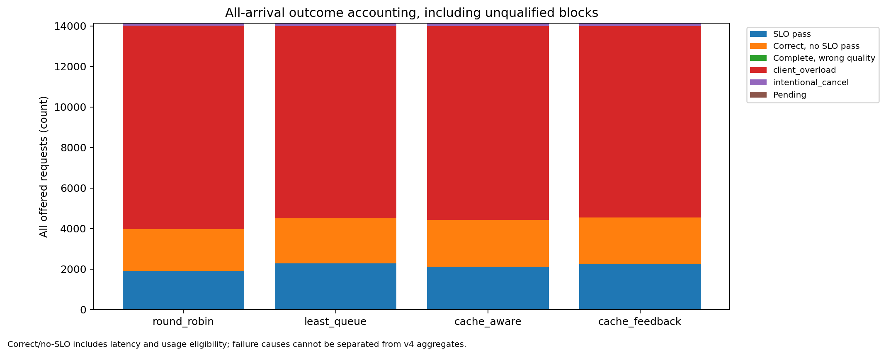
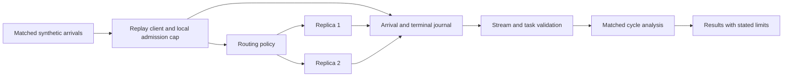

# Inference Evidence Lab

[](https://github.com/bojiang-li/inference-evidence-lab/actions/workflows/cpu.yml)

An inspectable inference experiment on two DGX Spark machines. Replay a matched workload, account for every offered request, and compare routing policies without hiding client overload or incomplete streams.

The repository includes the exact Python client and analysis code from an 8 hour experiment, CPU fixtures, compact results, a KV precision pilot, and a small vLLM correctness patch proposal. Documentation is in English. The interactive walkthrough is in Chinese.

## Start here

No Python packages or GPU are needed for the CPU checks. Python 3.9 or newer is supported by the included source.

```bash
python3 -B scripts/verify_release.py
PYTHONPATH=src python3 -B -m unittest discover -s tests -v
python3 -B -m http.server 8766 --bind 127.0.0.1
```

Open `http://127.0.0.1:8766/` for the interactive walkthrough. The test suite uses a local HTTP fixture, never an inference server. These commands do not start models or download weights.

## What was measured

The routing replay ran for **8h 14m 41.6s**, including request drains and orchestration overhead. Its 48 complete 600 second windows provide **8 hours of offered exposure** across 12 matched cycles. Each policy received 14,138 offered requests and 7,200 seconds of exposure.

| Policy | Completed requests | Requests passing the task and latency checks | Goodput, requests/s |
| --- | ---: | ---: | ---: |
| Round robin | 3,976 | 1,922 | 0.26694 |
| Least queue | 4,505 | 2,293 | 0.31847 |
| Cache aware | 4,422 | 2,123 | 0.29486 |
| Cache feedback | 4,549 | 2,261 | 0.31403 |

All **56,552 offered requests** have a terminal record. There were 17,452 completions, 38,570 local client admission rejections, and 530 intentional cancellations. Zero completed responses failed the limited retrieval task checker. Local admission rejection is not a server error.



The least queue point estimate is 19.3% above round robin **in this run**. The useful result is the reproducible accounting and matched comparison. Sequential warm cache state, a client cap of eight, synthetic prompts, and a short output budget limit how broadly the numbers apply. See [results and limits](docs/results.md) before using a performance claim.

## Three connected experiments

| Track | Engineering question | Deliverable |
| --- | --- | --- |
| A: routing | Which policy completes more correct requests within the chosen latency budget under the same offered trace? | Four policies, SSE validation, complete request ledger, cycle bootstrap |
| D: packed IPC | Can a logical weight transfer contain names and shapes but zero payload bytes? | A baseline failure, one line fix, two GPU regression cases, spawned consumer checks |
| E: KV precision | Does lower KV precision improve latency consistently across tasks and cache phases? | FP16/INT8/Q4_0 crossover, 27 held out cases, 324 requests, case level comparisons |



## Reproduce and extend

- [CPU verification and an endpoint replay](docs/reproduce.md)
- [Experiment protocol, measurements, and limits](docs/results.md)
- [vLLM patch and upstream submission checklist](docs/upstream-fix.md)
- [Interview explanation and resume wording](docs/interview.md)
- [Source pins and data selection](results/provenance.json)

The recorded deployment used Strata on GB10/SM121 with a Qwen3.8 Flash Next GGUF model. A new replay needs already configured endpoints, matching model IDs, streaming usage, and Strata's token count endpoint. The source is a research harness for that deployment. Endpoint compatibility and operating range must be checked before applying its settings elsewhere.

The release includes compact results rather than raw request journals. Readers can recompute A's aggregate comparisons and run CPU failure fixtures. Full raw journal verification and E's request level recomputation require the retained original journals or a new experiment. Raw prompts, weights, environment directories, host addresses, and machine lifecycle scripts are omitted.

## Status and attribution

This is an experiment artifact with verified CPU fixtures and compact evidence. The vLLM empty metadata patch is a proposal, not a submitted or merged contribution. [Alignment PR #57665](https://github.com/vllm-project/vllm/pull/57665) is a separate contribution.

AI tools assisted with implementation, analysis, the walkthrough, and documentation. The person presenting this project should be able to explain the protocol, source, failures, and measurement limits. The walkthrough was built using [HumanLayer's show-me skill](https://github.com/humanlayer/skills/tree/main/plugins/show-me/skills/show-me).

Apache-2.0. See [LICENSE](LICENSE) and [NOTICE](NOTICE).
