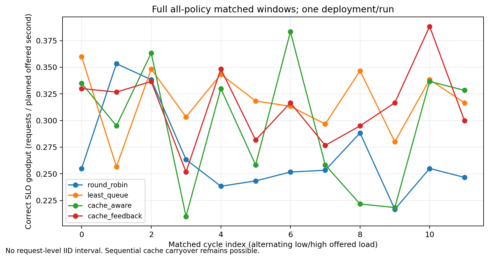
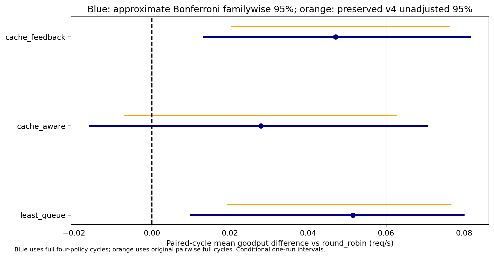

# Recorded results and their scope

## A: Routing replay

The replay started at 2026-10-11 07:54:55.009399 UTC and finished at 16:09:36.628145 UTC. Elapsed wall time was 29,681.618746 seconds. The sum of complete offered windows was 28,800 seconds. The remaining 881.618746 seconds includes drains and orchestration. It is not an isolated measurement of drain time or GPU utilization.

The frozen calibration selected a base rate of 1.68 requests/s, the highest tested grid value. This is not a capacity estimate. Held out cycles alternated nonburst rates of 1.176 and 2.184 requests/s. Every 120 seconds, the first 20 seconds had a 2x burst. All four policies shared a trace seed within each cycle. Policy order was shuffled, and physical replica ordering alternated by cycle. Intended cold namespaces were distinct by policy block.

The workload used four prefix families, two prompt sizes of roughly 2,889 and 9,842 measured tokens, a client cap of eight, and at most 64 output tokens. The frozen routing token proxy was calibrated for this model. The 20% intended cold and 3% intended cancellation settings describe the trace. Observed cancellations are lower because local admission rejection takes precedence.

Goodput is requests passing the task checker and chosen latency budget divided by the complete offered exposure. The chosen limits were 10 seconds to first visible content and 0.15 seconds for the visible TPOT proxy. This is not exact inter-token latency. SSE events are not tokens. Reasoning and missing usage can make a token denominator invalid, so the client keeps these cases explicit.

The task checker accepts a code fence normalized JSON object with the exact expected answer and schema. Zero failures on this checker does not establish general model quality or strict untouched response JSON.

### Matched comparisons

The unit of resampling is a complete four-policy cycle. There are 12 such units, not 56,552 independent latency comparisons. Each comparison uses 10,000 fixed seed bootstrap draws. The intervals below use percentile tails with a Bonferroni adjustment for the three planned comparisons against round robin.

| Candidate minus round robin | Mean goodput difference, requests/s | Approximate familywise 95% interval |
| --- | ---: | --- |
| Least queue | +0.051528 | [+0.010000, +0.079861] |
| Cache aware | +0.027917 | [-0.015882, +0.070556] |
| Cache feedback | +0.047083 | [+0.013333, +0.081483] |

These intervals condition on this single deployment. Temporal dependence and cache carryover can invalidate nominal coverage. There is no independent redeployment replication. Least queue has the highest point estimate, but a least queue versus cache feedback test was not planned. These data do not establish a universal winner or a novel routing algorithm.

The local raw journal auditor reparsed all 48 journals, matched unique arrivals to terminals, checked shared request metadata and prompt hashes, and recomputed task correctness. The public compact audit records that result. Since raw journals are not bundled, a reader cannot repeat the raw text checks from this release alone.

## D: Packed weight transfer

A nonempty tensor iterator can have zero bytes. The producer's final `if total_bytes:` omits all metadata in that case. The proposal changes it to `if names:`. An empty iterator still produces no chunks. A scalar has zero dimensions but usually one element, so it is a different case.

On the pinned vLLM main source, the two new regressions fail. With the fix, 31 tests pass, including 29 existing tests. Six positive separate spawned consumer controls and one controlled abort check pass. These cover solely empty tensors, mixed empty/scalar values, an empty iterator, retained owned copies over delayed multi-chunk reuse, and recovery.

The separate alignment PR passed 40 upstream tests and a 62 row IPC envelope. A real Qwen3-0.6B fixture completed 74 successful updates with matching values for 226 fused parameters and matching 16 greedy tokens. Those are alignment PR controls, not a substitute for testing the new empty metadata patch.

The alignment benchmark used a 2 GiB full weight chunk after diagnosing a model loader failure with a split 512 MiB transfer. Separate multi-chunk transport checks do not prove that every model loader accepts arbitrary chunk boundaries. The paired timing did not resolve an overhead difference. No speedup, equivalence, or serving throughput claim follows from it.

Shared CUDA tensor teardown warnings remain unresolved. Successful value and metadata checks do not establish leak freedom. See [the upstream proposal](upstream-fix.md).

## E: KV precision pilot

The pilot crossed FP16, INT8, and Q4_0 over both nodes with three configuration pairs. It covered 27 held out cases across needle retrieval, exact copy, and strict JSON tasks at roughly 1K, 4K, and 12K context. First and repeated requests were kept separate. All 324 requests passed task correctness, terminal stream checks, prompt token counts, and actual prompt hash validation. There were no parse exclusions or global prompt mismatches.

Each format comparison has 108 matched rows across 27 case clusters. Rows from two nodes and repeated requests do not create more independent cases. Each task/context/cache phase slice contains only three cases. Case bootstrap intervals are exploratory, condition on these observed deployments, and have no multiple comparison adjustment.

INT8's long first request mean TTFT was 1.814 seconds lower for needle retrieval and 1.865 seconds lower for copy, relative to FP16. Long repeated copy was about 49.9 milliseconds slower. Q4_0's long first request result was not stable, and long repeated requests were about 33 to 51 milliseconds slower. A lower bit width was not a consistent latency win.

Whole process memory was not an isolated KV allocation measurement. Sparse snapshots may miss peaks. This pilot establishes neither KV memory savings nor serving capacity, general model accuracy, p99 latency, or a format recommendation for every workload.

## Next useful experiment

Repeat the routing comparison after independent service restarts. Keep prompt generation and admission policy fixed, instrument server queue and KV occupancy directly, and compare a broader output length distribution. Run the selected router under each KV precision with the same offered trace. This would connect the sequential KV pilot to concurrent SLO goodput without treating the present pilot as proof of capacity.
